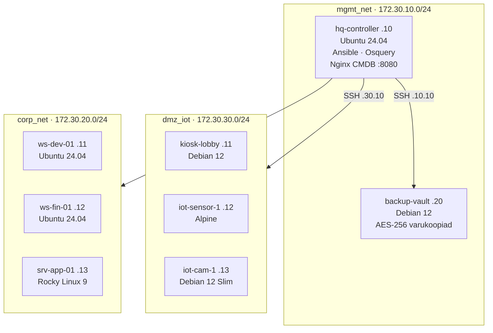

# ARCHITECTURE — CyberFleet 2026

NordicTech OÜ virtuaalne seadmepark: **8 konteinerit, 4 operatsioonisüsteemi, 3 võrgutsooni**,
keskhaldus Ansible'iga, seire Osquery'ga, krüpteeritud varundus.
E-ITS vastendus (varad ↔ moodulid ↔ meetmed): **[docs/E-ITS.md](docs/E-ITS.md)**.

## 1. Võrguskeem



> hq-controller on ainus konteiner, mis on ühendatud kõigi kolme võrguga. DMZ ↔ corp_net,
> DMZ ↔ mgmt_net ja corp_net ↔ backup-vault vahel **marsruut puudub** (eri Docker võrgud).

ASCII (ülesande skeem, meie IP-dega):

```
+--------------------------- mgmt_net 172.30.10.0/24 ---------------------------+
|  hq-controller 172.30.10.10            backup-vault 172.30.10.20              |
|  (Ansible, Osquery, Nginx :8080)       (AES-256 / OpenSSL varukoopiad)        |
+-------|-----------------------------------------------------------------------+
        | hq-controller on KÕIGIS kolmes võrgus (.10)
   +----+--------------------------+      +----------------------------------+
   | corp_net 172.30.20.0/24       |      | dmz_iot 172.30.30.0/24           |
   |  ws-dev-01   .11  Ubuntu      |      |  kiosk-lobby  .11  Debian 12     |
   |  ws-fin-01   .12  Ubuntu      |      |  iot-sensor-1 .12  Alpine        |
   |  srv-app-01  .13  Rocky 9     |      |  iot-cam-1    .13  Debian Slim   |
   +-------------------------------+      +----------------------------------+
   dmz_iot ✗ corp_net   dmz_iot ✗ mgmt_net   corp_net ✗ mgmt_net(backup-vault)
```

**Zero Trust tõestus** (`docs/evidence/week1_isolation_test.txt`):
`docker exec iot-sensor-1 ping -c 2 ws-fin-01` → `ping: bad address 'ws-fin-01'` — DMZ seade ei suuda
nimegi lahendada, sest Docker DNS annab nimesid ainult ühise võrgu sees; ühine võrk puudub.

## 2. IP-plaan

| Võrk | Alamvõrk | Konteiner | IP |
|---|---|---|---|
| mgmt_net | 172.30.10.0/24 | hq-controller | 172.30.10.10 |
| | | backup-vault | 172.30.10.20 |
| corp_net | 172.30.20.0/24 | hq-controller | 172.30.20.10 |
| | | ws-dev-01 | 172.30.20.11 |
| | | ws-fin-01 | 172.30.20.12 |
| | | srv-app-01 | 172.30.20.13 |
| dmz_iot | 172.30.30.0/24 | hq-controller | 172.30.30.10 |
| | | kiosk-lobby | 172.30.30.11 |
| | | iot-sensor-1 | 172.30.30.12 |
| | | iot-cam-1 | 172.30.30.13 |

## 3. Seadmete rollid

| Konteiner | OS | Image | Roll | Ansible grupp | Lubatud pordid |
|---|---|---|---|---|---|
| hq-controller | Ubuntu 24.04 | `Dockerfiles/hq-controller` | Ansible, Osquery, Nginx CMDB (8080→80), cron, SSH privaatvõti, varunduse krüptovõti | (localhost) | 80 |
| backup-vault | Debian 12 | `Dockerfiles/debian` | ainult šifreeritud varukoopiad `/srv/backups` (0700) | `vault` | 22 |
| ws-dev-01 | Ubuntu 24.04 | `Dockerfiles/ubuntu` | arendaja: git, python3, vim, htop, sudo | `workstations` | 22 |
| ws-fin-01 | Ubuntu 24.04 | `Dockerfiles/ubuntu` | raamatupidaja: `~/Raamatupidamine_2026`, umask 0077, ilma sudota | `workstations` | 22 |
| srv-app-01 | Rocky Linux 9 | `Dockerfiles/rocky` | siseveeb/ärirakendus (python http :8000), dnf/rpm | `servers` | 22, 8000 |
| kiosk-lobby | Debian 12 | `Dockerfiles/debian` | infokiosk, kasutaja `kiosk` rbash-iga | `kiosks` | 22 |
| iot-sensor-1 | Alpine 3.20 | `Dockerfiles/alpine` | kirjutab iga minut `/var/log/sensor.log` | `iot` | 22 |
| iot-cam-1 | Debian 12 Slim | `Dockerfiles/debian-slim` | IP-kaamera simulaator; **teadlikult nõrk** algseadistus | `iot` | 22 |

Ansible inventar (`hosts.ini`) — grupid `[workstations] [servers] [kiosks] [iot] [vault]` ning
tsoonigrupid `[corp:children] [dmz:children] [mgmt:children]`. Ühised muutujad: `group_vars/all.yml`.

## 4. Andmevood

| Voog | Kust → kuhu | Kanal |
|---|---|---|
| Haldus | hq-controller → kõik 7 | SSH (Ed25519 võti, ainult kasutaja `ansible`, sudo NOPASSWD) |
| Telemeetria | kõik → hq-controller | Ansible käivitab `osqueryi --json` / `cf-telemetry`, JSON tagasi |
| CMDB | hq-controller → brauser | Nginx `localhost:8080` (`/var/www/html/index.html`) |
| Varundus | klient → hq-controller → backup-vault | tar.gz → **AES-256 hq-controlleris** → SSH → vault (+SHA-256) |
| Taaste | backup-vault → hq-controller → ws-fin-01 | SHA-256 kontroll → dekrüpteerimine → `tar --skip-old-files` |

Kliendid ei näe backup-vault'i (eri võrgud) — varundus käib alati läbi hq-controlleri.
Krüptovõti ei lahku kunagi hq-controllerist → varundusserveri kompromiteerimine ei paljasta andmeid.

## 5. Turvameetmed nädalate kaupa

| Nädal | Meede | Kuidas | Fail |
|---|---|---|---|
| 1 | Võrgu segmenteerimine | 3 bridge-võrku, DMZ ainult `dmz_iot` | `docker-compose.yml` |
| 1 | Paroolivaba haldus | Ed25519 võti, `ssh-copy-id` kõigile 7 | `scripts/distribute_keys.sh` |
| 2 | ITAM / CMDB | Osquery (Ubuntu/Debian/Rocky), `cf-telemetry` (Alpine) | `01`, `02` |
| 2 | Rollipõhised profiilid | arendaja (sudo), raamatupidaja (umask 0077, ilma sudota), kiosk (rbash, readonly PATH) | `03`, `profiles/` |
| 3 | SSH karastamine | `PasswordAuthentication no`, `PermitRootLogin no`, `MaxAuthTries 3`, bänner; drop-in `00-cyberfleet.conf` võidab teisi drop-in faile | `04` |
| 3 | Ründepinna vähendamine | kioskist/IoT-st telnet, netcat, gcc, make, BusyBox `nc`/`telnet` lingid eemaldatud (python3 jääb — Ansible vajab) | `04` |
| 3 | Self-healing | cron iga 10 min `04_hardening.yml`; iga 5 min `02`+`05`; öösel `06` | `04` → `/etc/cron.d/cyberfleet` |
| 3 | HIDS / FIM | SHA-256 baasjoon, `on_disk = 0`, /tmp protsessid, UID=0, lubamata pordid → punane | `05` |
| 3 | Krüpteeritud varundus | AES-256-CBC, PBKDF2 200 000, sool, SHA-256, säilitus 10 koopiat | `06` |
| 4 | Intsidendile reageerimine | kontode eemaldus, pahavara karantiin + kill, pordi sulgemine, failide taaste, uuesti karastamine ja audit | `07` |

## 6. Disainiotsused ja leitud lõksud

1. **Docker ≠ VM.** systemd puudub → `sshd -D` on esiplaanil, hq-controlleris käivitab cron/nginx
   `entrypoint.sh`. Kõigil teenustel `init: true` (tini PID 1) — koristab zombi-protsessid.
2. **Rocky Linux 9 `coreutils-single`.** Seal on `/bin/sleep` vaid skript-ümbris `/usr/bin/coreutils`
   ümber; ründaja koopia `/tmp/xmr_miner` käivitaks tegelikult `coreutils`-i, mis on kettal olemas →
   `on_disk = 0` ei leiaks kaevurit. Lahendus: image'is täis-`coreutils` **ja** lisareegel
   „protsess käivitatud /tmp, /var/tmp või /dev/shm alt“.
3. **Kioskis python3 jääb alles** — ilma selleta ei tööta Ansible ega õpetaja ründeskript.
4. **nginx ja IPv6.** Kui Dockeris IPv6 puudub, ei käivitu nginx rea `listen [::]:80` tõttu → eemaldatud.
5. **sshd drop-in failid.** Ubuntu/Debian/Rocky loevad `sshd_config.d/*.conf` *enne* põhifaili ja
   esimene väärtus võidab → meie seaded on failis `00-cyberfleet.conf` **ja** põhifailis.
6. **Alpine'i konto lukk.** `adduser -D` loob lukus konto, sshd ei luba siis ka võtmega → `chpasswd`.
7. **Paroolid Gitis ainult räsidena** (SHA-512), SSH paroolisisselogimine on niikuinii keelatud.
