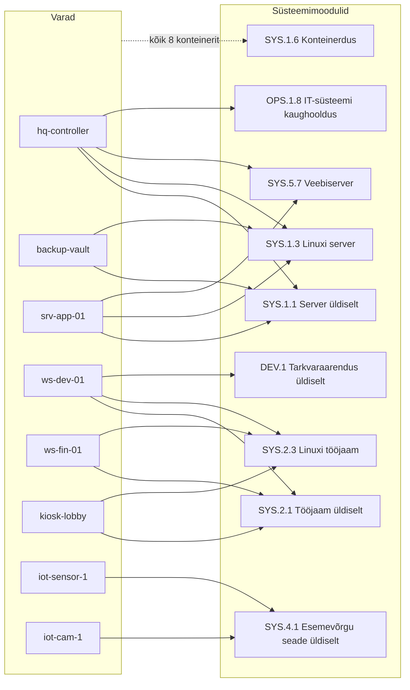

# CyberFleet 2026 — E-ITS vastendus (modelleerimine)

> Allikas: **Eesti infoturbestandard E-ITS, versioon 2026** — <https://eits.ria.ee/et>
> (infoturbekataloog loetud 21.11.2026).
>
> E-ITS ISMS-nõuete **§ 5 lg 2 p 2** nõuab: *„vara ja äriprotsessi vastendamine infoturbekataloogi
> moodulitega“*. See dokument teeb seda NordicTech OÜ CyberFleet seadmepargi jaoks:
> **struktuurianalüüs → kaitsetarve → modelleerimine (vara ↔ moodulid) → meetmete rakendusplaan**.

> ℹ️ Ülesande PDF viitab vanadele moodulikoodidele **CON.8 Tarkvaraarendus** ja **OPS.1.1.4 Kaitse
> pahavara eest**. E-ITS 2026 kataloogis on samad teemad moodulites **DEV.1 Tarkvaraarendus üldiselt**
> ja **OPS.1.9 Kaitse kahjurprogrammide eest** (vastavus pealkirja järgi; täpse vastavuse saab
> kontrollida portaali „Versioonikonverteriga“).

---

## 1. Struktuurianalüüs — äriprotsessid ja varad

| Äriprotsess | Kasutatavad varad |
|---|---|
| **P1 Raamatupidamine** (arved, palgad, eelarve) | ws-fin-01, backup-vault, hq-controller |
| **P2 Tarkvaraarendus** (siserakendus nordic-app) | ws-dev-01, srv-app-01, backup-vault |
| **P3 Siseveeb ja ärirakendus** | srv-app-01 |
| **P4 Klienditeenindus fuajees** | kiosk-lobby |
| **P5 Tootmise seire** (temperatuur, videovalve) | iot-sensor-1, iot-cam-1 |
| **P6 IT-haldus ja küberkaitse** (Ansible, Osquery, CMDB, varundus) | hq-controller, backup-vault, kõik võrgud |

| Vara | Tüüp | OS | Võrk / IP | Omanik |
|---|---|---|---|---|
| hq-controller | haldusserver | Ubuntu 24.04 | mgmt/corp/dmz `.10` | IT-juht |
| backup-vault | varundusserver | Debian 12 | mgmt_net 172.30.10.20 | IT-juht |
| ws-dev-01 | tööjaam | Ubuntu 24.04 | corp_net 172.30.20.11 | arendusjuht |
| ws-fin-01 | tööjaam | Ubuntu 24.04 | corp_net 172.30.20.12 | finantsjuht |
| srv-app-01 | rakendusserver | Rocky Linux 9 | corp_net 172.30.20.13 | IT-juht |
| kiosk-lobby | avalik kiosk | Debian 12 | dmz_iot 172.30.30.11 | kontorijuht |
| iot-sensor-1 | IoT-andur | Alpine 3.20 | dmz_iot 172.30.30.12 | tootmisjuht |
| iot-cam-1 | IP-kaamera | Debian 12 Slim | dmz_iot 172.30.30.13 | turvajuht |
| mgmt_net / corp_net / dmz_iot | võrgusegmendid | Docker bridge | 172.30.10/20/30.0/24 | IT-juht |

## 2. Kaitsetarve (K = konfidentsiaalsus, T = terviklus, S = käideldavus)

Skaala: **tavaline / kõrge / väga kõrge**. Kaitsetarve päritakse äriprotsessilt (maksimumi põhimõte).

| Vara | K | T | S | Põhjendus |
|---|---|---|---|---|
| hq-controller | **väga kõrge** | **väga kõrge** | kõrge | hoiab SSH privaatvõtit ja varunduse krüptovõtit; kompromiteerimine = kogu pargi kaotus |
| backup-vault | kõrge | **väga kõrge** | kõrge | viimane kaitseliin lunavara vastu; hoiab ainult šifreeritud andmeid |
| ws-fin-01 | **väga kõrge** | **väga kõrge** | kõrge | finants- ja palgaandmed (isikuandmed), seadusjärgne säilitamine |
| ws-dev-01 | kõrge | kõrge | tavaline | lähtekood (ärisaladus) |
| srv-app-01 | kõrge | kõrge | kõrge | siseveeb ja ärirakendus |
| kiosk-lobby | tavaline | kõrge | tavaline | avalik füüsiline ligipääs → suurim ründepind |
| iot-sensor-1 | tavaline | kõrge | kõrge | tootmisandmete õigsus |
| iot-cam-1 | kõrge | kõrge | tavaline | videovalve (isikuandmed); nõrk tehaseseadistus |

## 3. Modelleerimine — vastendusskeem (vara ↔ E-ITS moodulid)

**Protsessimoodulid** (kehtivad kogu pargile, E-ITS § 7 lg 4 — lõimitakse igapäevatöösse):
GRC.3 Varade haldus · GRC.5 Krüptograafia · ORP.1.1 Identiteedi- ja õiguste haldus ·
OPS.1.2 Muudatusehaldus · OPS.1.3 Andmevarundus · OPS.1.5 Turvasündmuse logimine ·
OPS.1.9 Kaitse kahjurprogrammide eest · OPS.3.1 Süsteemi haldus üldiselt ·
DER.1 Turvaintsidendi avastamine · DER.2.1 Turvaintsidendi käsitlus · DER.3 Turvatestimine ja õppus ·
DER.4 Talitluspidevus. **Võrk:** NET.1.1 Võrguhaldus üldiselt · NET.1.2 Kohtvõrk.

Sama tabelina:

| Vara | Süsteemimoodulid | Olulisimad protsessimoodulid |
|---|---|---|
| hq-controller | SYS.1.6, SYS.1.1, SYS.1.3, SYS.5.7, OPS.1.8 | OPS.3.1, GRC.5, DER.1, DER.2.1, OPS.1.5 |
| backup-vault | SYS.1.6, SYS.1.1, SYS.1.3 | OPS.1.3, GRC.5, DER.4 |
| srv-app-01 | SYS.1.6, SYS.1.1, SYS.1.3, SYS.5.7 | OPS.1.9, OPS.1.3 |
| ws-dev-01 | SYS.1.6, SYS.2.1, SYS.2.3, DEV.1 | ORP.1.1, OPS.1.3 |
| ws-fin-01 | SYS.1.6, SYS.2.1, SYS.2.3 | ORP.1.1, OPS.1.3, DER.4 |
| kiosk-lobby | SYS.1.6, SYS.2.1, SYS.2.3 | ORP.1.1, OPS.1.9 |
| iot-sensor-1 | SYS.1.6, SYS.4.1 | OPS.1.3, OPS.1.5 |
| iot-cam-1 | SYS.1.6, SYS.4.1 | OPS.1.9, ORP.1.1 |
| 3 võrgusegmenti | NET.1.1, NET.1.2 | — |
| Kogu park | GRC.3, OPS.1.2, OPS.3.1, DER.1, DER.2.1, DER.3 | — |

## 4. Meetmete rakendusplaan (meede → teostus projektis)

| E-ITS meede | Teostus CyberFleetis | Fail | Staatus |
|---|---|---|---|
| **NET.1.1.M4** Võrgu segmentimine; **NET.1.2.M4** Kohtvõrgu tsoneerimine | 3 Docker võrku; DMZ seadmed ainult `dmz_iot` võrgus; ainult hq-controller on kõigis | `docker-compose.yml` | ✅ testitud (`docs/evidence/week1_isolation_test.txt`) |
| **NET.1.1.M17** Haldusvõrkude eraldamine | backup-vault ainult `mgmt_net`; kliendid ei näe varundusserverit | `docker-compose.yml` | ✅ |
| **NET.1.1.M3** Võrgu arhitektuuri dokumentatsioon | võrguskeem, IP-plaan | `ARCHITECTURE.md` | ✅ |
| **OPS.3.1.M1** Keskne haldustoimingute teostamine; **OPS.3.1.M15** Keskne konfiguratsioonihaldus | Ansible hq-controllerist, inventar gruppidega | `hosts.ini`, `playbooks/` | ✅ |
| **OPS.3.1.M8** Turvaseisundi regulaarne lahknevusanalüüs | cron iga 10 min käivitab 04 → triivi automaatne parandus (self-healing) | `04_hardening.yml` | ✅ testitud |
| **OPS.1.8.M3** Sideühenduste turve kaughooldusel; **SYS.1.3.M8** SSH-ga krüpteeritud andmevahetus | SSH Ed25519 võtmed, paroolid keelatud, root keelatud | `distribute_keys.sh`, `04` | ✅ |
| **ORP.1.1.M1/M2** Kasutajakontode haldus, õiguste andmine | rollipõhised profiilid: arendaja (sudo), raamatupidaja (ilma sudota), kiosk (rbash) | `03_profiles.yml`, `profiles/` | ✅ |
| **SYS.2.3.M7** Faili- ja kataloogiõiguste piiramine; **SYS.2.1.M28** Konfidentsiaalsete andmete talletamine | raamatupidajal `umask 0077`, kaust 0700, failid 0600 | `03`, `04` | ✅ |
| **SYS.2.1.M10** Tööjaamade profileerimine; **SYS.2.1.M30** Etaloninstall | „kuldsed profiilid“ mallidena repos | `profiles/` | ✅ |
| **SYS.2.1.M16 / SYS.4.1.M13 / SYS.1.1.M6** Tarbetute komponentide desaktiveerimine | kioskist ja IoT-st eemaldatakse telnet, netcat, kompilaatorid | `04_hardening.yml` | ✅ |
| **SYS.4.1.M10** IoT seadme turvaline seadistus | iot-cam-1 nõrk tehaseseadistus (root:root, parooliga SSH) parandatakse keskselt | `04_hardening.yml` | ✅ |
| **GRC.3.M4** Varade register; **GRC.3.M7** Keskne varahaldussüsteem; **SYS.2.1.M4** Tööjaamade register | Osquery CMDB: OS, tuum, CPU, RAM, paketid, kasutajad, pordid | `01`, `02`, http://localhost:8080 | ✅ |
| **DER.1.M9** Automaatsed avastussüsteemid; **SYS.1.1.M20** Hostipõhine ründekaitse | Osquery HIDS + cron iga 5 min | `05_security_audit.yml` | ✅ |
| **DER.1.M18** Failide tervikluse automaatkontroll | SHA-256 baasjoon `/etc/passwd`, `/etc/shadow`, `sshd_config`, `sudoers` | `05_security_audit.yml` | ✅ testitud |
| **OPS.1.9.M2** Süsteemikohased turvamehhanismid; **OPS.1.9.M9** Kahjurprogrammi avastamisest teatamine | `processes WHERE on_disk = 0`, protsessid /tmp-st, UID=0 kontod → punane häire armatuurlaual | `05`, dashboard | ✅ testitud |
| **OPS.1.3.M2/M3** Varundusplaan; **OPS.1.3.M10** Krüptograafia varundusel; **OPS.1.3.M11** Varukoopiate turve | AES-256-CBC (OpenSSL, PBKDF2 200k), SHA-256, backup-vault 0700, ainult šifreeritud tekst | `06_fleet_backup.yml` | ✅ |
| **OPS.1.3.M8** Varunduse regulaarne testimine | taaste on osa 07-st, iga õppusega testitud | `07_incident_response.yml` | ✅ testitud |
| **GRC.5.M7** Turvaline võtmehaldus | krüptovõti ainult hq-controlleri köites (0600), mitte kunagi varundusserveris ega Gitis | `06`, `.gitignore` | ⚠️ võtme koopia tuleb hoida ka võrguühenduseta (seif) |
| **DER.2.1.M10** Intsidendi toime piiramine; **DER.2.1.M6** Töökeskkonna taastamine | 07: tagaukse kontode eemaldus, pahavara tapmine, pordi sulgemine, failide taaste | `07_incident_response.yml` | ✅ 35 s |
| **DER.2.1.M16** Turvaintsidentide dokumenteerimine; **DER.2.2** asitõendid | `incident_*.json`, pahavara näidis karantiini (`/root/quarantine`) | `07`, `INCIDENT_REPORT.md` | ✅ |
| **DER.3.M2/M5** Turvaõppused ja neist õppimine | Chaos Monkey õppus, leitud 2 viga ründeskriptis, parandused | `scripts/chaos_attack.sh`, `INCIDENT_REPORT.md` | ✅ |
| **OPS.1.5.M3** Turvasündmuste logimine; **OPS.1.5.M6** Keskne logitaristu | auditi ajalugu `audit_*.json`, cron logid `/var/log/cyberfleet` | `05`, `04` | ⚠️ osaline (keskne SIEM puudub) |
| **SYS.1.6.M5** Konteinerite haldusvõrgu eraldamine; **SYS.1.6.M15** ressursipiirangud | haldus ainult `mgmt_net` kaudu; `init: true` | `docker-compose.yml` | ⚠️ ressursipiirangud — edasiarendus |
| **SYS.5.7.M11** TLS veebiserveris | CMDB on ainult localhostis (port 8080) | — | ⚠️ edasiarendus (TLS + autentimine) |
| **ORP.1.1.M21** Mitmikautentimine | ws-fin-01: SSH ainult `AllowUsers ansible raamatupidaja` | `04` | ⚠️ MFA (TOTP PAM) — edasiarendus |

## 5. Jääkriskid ja aktsepteerimine (E-ITS § 7 lg 6)

| Risk | Põhjus | Otsus |
|---|---|---|
| Kõigil konteineritel on sama tuum (host kernel) | Docker arhitektuur | aktsepteeritud õppekeskkonnas |
| hq-controller on üks tõrkepunkt (SPOF) | üks juhtsõlm | aktsepteeritud; võti ja konfiguratsioon on Gitis/köites taastatavad |
| CMDB ilma autentimiseta | õppelabor, ainult localhost | aktsepteeritud; tootmises reverse proxy + TLS + SSO |
| Osquery puudub Alpine'il | ametlik tugi puudub | asendatud `cf-telemetry` skriptiga (samad väljad) |
